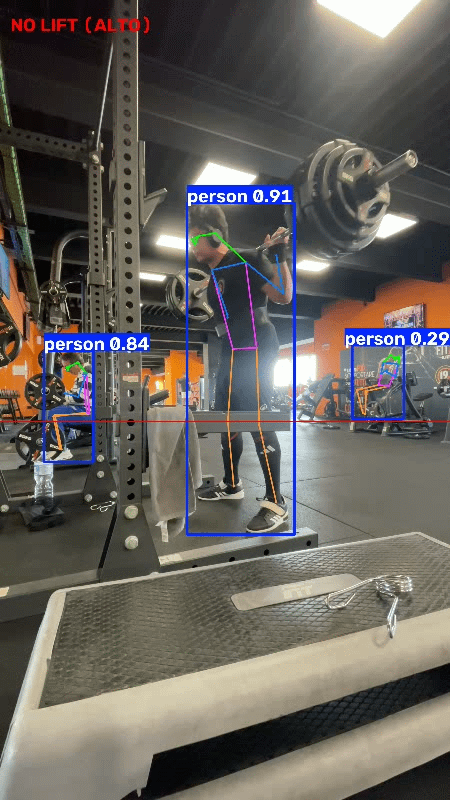

# 🏋️‍♂️ AI Powerlifting Squat Validator

   



Un sistema di Computer Vision basato su \*\*YOLOv8 Pose Estimation\*\* e \*\*OpenCV\*\* per analizzare e validare in automatico la profondità dello squat secondo gli standard delle gare di Powerlifting (FIPL/IPF).


## 📌 Panoramica del Progetto

Il sistema elabora un video di un'alzata (registrato lateralmente) e traccia lo scheletro dell'atleta in tempo reale. Calcola dinamicamente la posizione dell'anca rispetto al ginocchio per determinare se il parallelo è stato rotto. Il risultato viene esportato in un nuovo file video mantenendo il framerate originale.


### ✨ Funzionalità

- **Pose Estimation avanzata:** Utilizza il modello `yolov8l-pose` per la massima precisione, capace di distinguere le articolazioni anche con abbigliamento scuro e ginocchiere.

- **Validazione IPF Standard:** La logica matematica certifica l'alzata solo quando la piega dell'anca scende sotto la sommità del ginocchio.

- **Occlusion-Proof:** Analizza in modo rigido solo il lato del corpo a favore di camera, ignorando i falsi positivi causati dall'occlusione della gamba opposta.

- **Hardware Accelerated:** Ottimizzato per inferenza ultra-veloce su GPU NVIDIA (testato su architettura Blackwell `sm\_120` - RTX 5070 Ti).


---


## ⚙️ Come Funziona (Sotto il cofano)

Nelle librerie di elaborazione grafica come OpenCV, **l'asse Y è invertito** (il valore 0 è in cima allo schermo e cresce verso il basso). 

Di conseguenza, il momento in cui si "rompe il parallelo" nello squat si verifica matematicamente quando la coordinata Y dell'anca diventa *maggiore* della coordinata Y del ginocchio.


Nel codice estraiamo i keypoints specifici generati da YOLO:

*   `Keypoint 12`: Anca Destra

*   `Keypoint 14`: Ginocchio Destro


Il sistema disegna una linea di demarcazione dinamica sul ginocchio (Keypoint 14). Se `Y\_Anca > Y\_Ginocchio`, lo schermo restituisce semaforo verde (Valido).


> **Nota sull'angolo di ripresa:** Lo script attuale è configurato per video registrati dal **lato destro** dell'atleta. Se il video è registrato dal lato sinistro, è necessario modificare gli indici dei keypoints nel codice a `11` (Anca Sx) e `13` (Ginocchio Sx).


---


## 🚀 Setup e Installazione


### 1. Prerequisiti

Si consiglia di utilizzare **Python 3.12** in un ambiente virtuale isolato.


```bash

# Creazione e attivazione dell'ambiente virtuale (Windows)

py -3.12 -m venv venv

.\\venv\\Scripts\\activate

```


### 2. Configurazione GPU (Importante per RTX Serie 4000/5000)

Per sfruttare le schede video di ultimissima generazione (es. RTX 5070 Ti con architettura Blackwell), la versione standard di PyTorch per CPU/CUDA 12.1 non è sufficiente. È necessario installare la build Nightly con supporto **CUDA 13.0** (o superiore):


```bash

pip install --pre torch torchvision torchaudio --index-url https://download.pytorch.org/whl/nightly/cu130

```


### 3. Installazione Librerie

```bash

pip install ultralytics opencv-python

```


---


## 🏃‍♂️ Utilizzo


1. Inserisci il tuo video (es. `squat\_video.mov`) nella directory principale del progetto.

2. Modifica la variabile `video\_path` all'interno dello script `squat-cv.py` con il nome del tuo file.

3. Esegui lo script:

```bash
    python squat-cv.py
```

4. Attendi l'elaborazione (il terminale mostrerà il progresso). A elaborazione conclusa, troverai il file validato `squat\_analizzato.mp4` nella cartella.


---


## 🔮 Sviluppi Futuri (To-Do)

- [ ] Implementare un contatore automatico di ripetizioni (`rep counter`) basato sull'inversione di traiettoria dell'anca.

- [ ] Aggiungere il tracciamento del **Bar Path** (traiettoria del bilanciere) tramite Object Tracking per analizzare lo sbilanciamento del peso sul centro-piede.

- [ ] Auto-rilevamento del lato (capire in automatico se l'atleta è inquadrato da destra o da sinistra).


---

*Progetto sviluppato come unione tra Computer Vision applicata e Powerlifting.*

